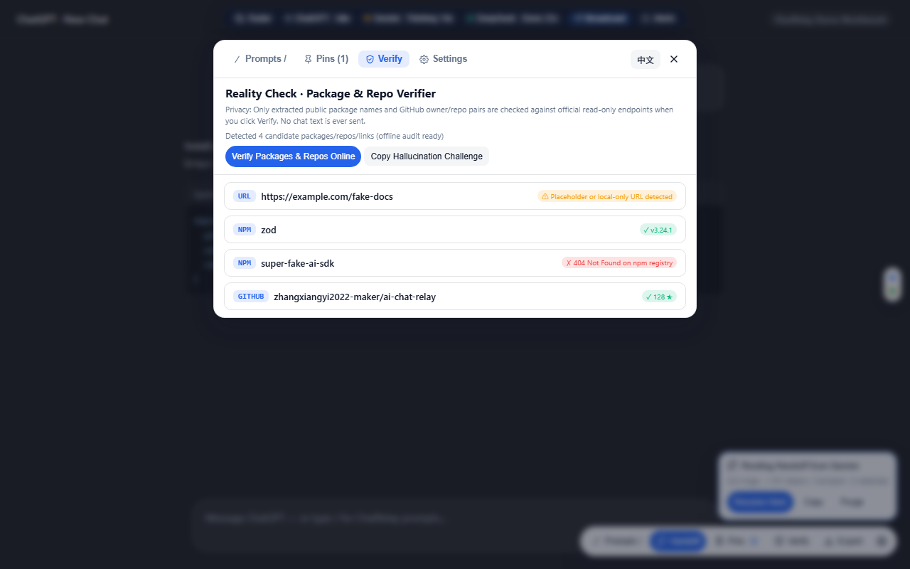
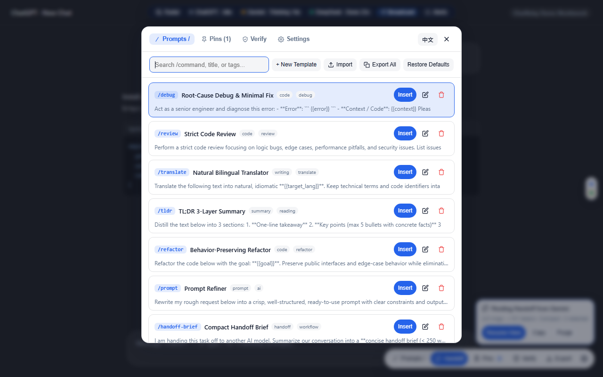

# ChatRelay — Cross-AI Cockpit

[](https://github.com/zhangxiangyi2022-maker/ai-chat-relay/releases/latest)
[](https://github.com/zhangxiangyi2022-maker/ai-chat-relay/actions)
[](./LICENSE)
[](./PRIVACY.md)

[中文文档](./README.zh-CN.md) · [Privacy Policy](./PRIVACY.md) · [GreasyFork](https://greasyfork.org/zh-CN/scripts/607263-chatrelay-cross-ai-prompt-context-handoff) · [Request New AI Platform](https://github.com/zhangxiangyi2022-maker/ai-chat-relay/issues/new?template=platform_request.yml)

**Cross-AI Cockpit & HUD** for **ChatGPT, Gemini, Claude, and DeepSeek** — built from a single TypeScript codebase into both a **Chrome/Edge Extension (MV3)** and a **Tampermonkey/Violentmonkey Userscript**.

## Preview

| Dynamic Island, Timeline & Handoff | Anti-Hallucination Reality Check |
| :---: | :---: |
|  |  |

| `/` Prompt & Playbook Palette | Built-in Privacy & HUD Controls |
| :---: | :---: |
|  |  |

## Features (`v1.0`)

1. **Right-Edge Metro Timeline & Conversation Fork**
   - Floating dot-rail timeline along the right edge with badges for `Code`, `Math`, and `Table`.
   - Click to jump & highlight any turn, **Mute** wrong/noisy turns so they are excluded from exports, or **Fork Here** to package turns `1..k` into a clean new branch.
2. **Multi-Tab Dynamic Island Radar & Broadcast**
   - Sleek top pill tracking all open AI tabs in real time (`Thinking 14s...`, `Done 22s`, `Idle`) with optional native desktop notifications when a background model finishes.
   - **Broadcast Prompt**: type once and dispatch to multiple open AI tabs simultaneously (fill-only or auto-submit).
3. **Pinboard ("Idea Backpack")**
   - Highlight any text inside a chat to click **Pin Snippet**, or pin any turn directly from the Timeline.
   - Collect snippets across ChatGPT/Gemini/Claude/DeepSeek, export as a clean Markdown note, or feed all pins to your current AI.
4. **Anti-Hallucination Reality Check (`Verify`)**
   - Automatically scans AI replies for `npm` packages, `PyPI` packages, `GitHub` repos, and suspicious placeholder URLs (`example.com`, `localhost`).
   - On-demand button verifies existence/versions/stars directly against `registry.npmjs.org`, `pypi.org`, and `api.github.com` (never sends chat text) and generates a 1-click **"Hallucination Challenge"** prompt if any 404s appear.
5. **Cross-Platform Handoff, `/` Prompt Palette & Lossless Markdown Export**
   - Type `/` (or `Ctrl+Shift+P`) for 8 built-in bilingual templates with `{{var}}` fill-in modal and Markdown/JSON import-export.
   - 1-click **Handoff** across tabs with **auto-redaction** of API keys, JWTs, private keys, DB passwords, emails, and phone numbers + **burn-after-read** & **30-min auto-expiry**. See [PRIVACY.md](./PRIVACY.md).

## Supported Platforms

- **ChatGPT**: `https://chatgpt.com/`, `https://chat.openai.com/`
- **Gemini**: `https://gemini.google.com/`
- **Claude**: `https://claude.ai/`
- **DeepSeek**: `https://chat.deepseek.com/`

## Installation

### Option 1: Chrome / Edge Extension (No extra extension required)

1. Download [`chat-relay-extension.zip`](https://github.com/zhangxiangyi2022-maker/ai-chat-relay/releases/latest/download/chat-relay-extension.zip) from [Releases](https://github.com/zhangxiangyi2022-maker/ai-chat-relay/releases/latest) (or run `npm run build` locally) and unzip it.
2. Open `chrome://extensions/` (or `edge://extensions/`), enable **Developer mode**, click **Load unpacked**, and select the unzipped folder.

### Option 2: Userscript (Tampermonkey / Violentmonkey)

1. Install [Tampermonkey](https://www.tampermonkey.net/) or [Violentmonkey](https://violentmonkey.github.io/).
2. Install via [GreasyFork](https://greasyfork.org/zh-CN/scripts/607263-chatrelay-cross-ai-prompt-context-handoff) or direct [GitHub Release script](https://github.com/zhangxiangyi2022-maker/ai-chat-relay/releases/latest/download/chat-relay.user.js).

## Development

```bash
npm install
npm run typecheck
npm test
npm run build
```

## License

[MIT](./LICENSE)
