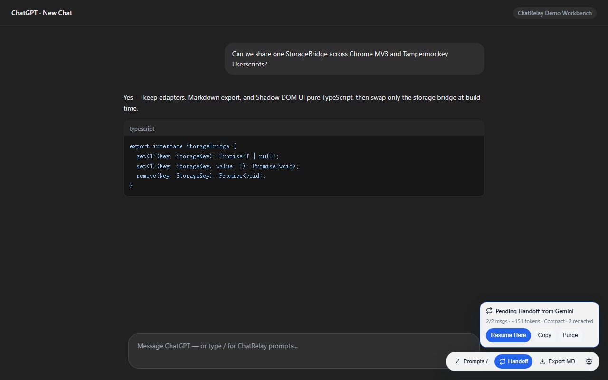
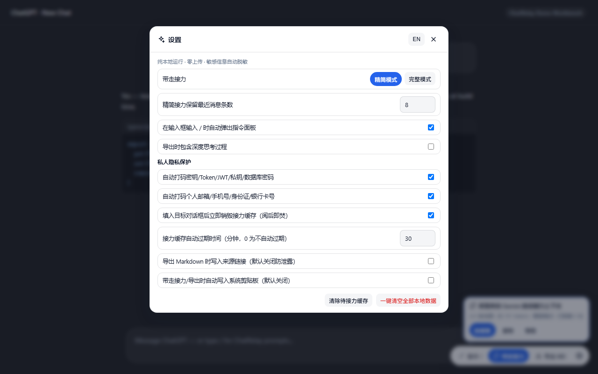

# ChatRelay

[](https://github.com/zhangxiangyi2022-maker/ai-chat-relay/releases/latest)
[](https://github.com/zhangxiangyi2022-maker/ai-chat-relay/actions)
[](./LICENSE)
[](./PRIVACY.md)

[中文文档](./README.zh-CN.md) · [Privacy Policy](./PRIVACY.md) · [Request New AI Platform](https://github.com/zhangxiangyi2022-maker/ai-chat-relay/issues/new?template=platform_request.yml)

**Cross-AI Prompt Palette, Context Handoff, and Clean Markdown Exporter** for **ChatGPT, Gemini, Claude, and DeepSeek** — built from a single TypeScript codebase into both a **Chrome/Edge Extension (MV3)** and a **Tampermonkey/Violentmonkey Userscript**.

## Preview

| Cross-Platform Context Handoff | `/` Prompt & Playbook Palette | Built-in Privacy & Auto-Redaction |
| :---: | :---: | :---: |
|  |  |  |

## Features

- **`/` Slash Command & Prompt Playbook Palette**
  - Type `/` in any supported chat box (or press `Ctrl+Shift+P` / `Cmd+Shift+P`) to summon your templates.
  - Supports `{{variable}}` placeholders with a quick fill-in modal before inserting.
  - Includes 8 built-in bilingual templates (`/debug`, `/review`, `/translate`, `/tldr`, `/refactor`, `/prompt`, `/handoff-brief`, `/playbook`) plus custom CRUD, Markdown Playbook import/export, and JSON import.
- **Cross-Platform Context Handoff ("Relay Baton")**
  - Stuck or hitting rate limits on Gemini / ChatGPT / Claude / DeepSeek? Click **Handoff** to package the conversation into a structured briefing prompt (Compact mode keeps your initial goal + recent turns; Full mode keeps everything).
  - Switch to another AI tab and a floating **"Pending Handoff"** capsule appears automatically so you can resume in one click.
- **Lossless Markdown Export**
  - Converts DOM conversation turns to clean Markdown with detected code block languages, stripped `"Copy code"` UI chrome, KaTeX LaTeX extraction (`$...$` / `$$...$$`), pipe tables, and optional model thinking blocks.
- **100% Local & Privacy-First**
  - Zero backend server, zero telemetry, zero network requests. Shadow DOM UI built with pure DOM APIs (`innerHTML`-free) for strict Trusted Types sites like `gemini.google.com`.
  - **Auto-Redaction On by Default**: Automatically masks API keys, JWTs, private keys, DB passwords, emails, and phone numbers before Handoff or Markdown export.
  - **Burn-After-Read & Auto-Expire**: Handoff cache stores only a one-way URL fingerprint (never raw conversation URLs), auto-purges right after pasting, and expires after 30 minutes. See [PRIVACY.md](./PRIVACY.md).
- **Dual Build from One Codebase**
  - `npm run build` outputs both `dist/extension/` (+ `dist/chat-relay-extension.zip`) and `dist/userscript/chat-relay.user.js`.

## Supported Platforms

- **ChatGPT**: `https://chatgpt.com/`, `https://chat.openai.com/`
- **Gemini**: `https://gemini.google.com/`
- **Claude**: `https://claude.ai/`
- **DeepSeek**: `https://chat.deepseek.com/`

Want another platform (Grok, Kimi, Perplexity, Qwen)? [Open a Platform Request](https://github.com/zhangxiangyi2022-maker/ai-chat-relay/issues/new?template=platform_request.yml).

## Installation

### Option 1: Chrome / Edge Extension (No extra extension required)

1. Download [`chat-relay-extension.zip`](https://github.com/zhangxiangyi2022-maker/ai-chat-relay/releases/latest/download/chat-relay-extension.zip) from [Releases](https://github.com/zhangxiangyi2022-maker/ai-chat-relay/releases/latest) (or run `npm run build` locally) and unzip it.
2. Open `chrome://extensions/` (or `edge://extensions/`).
3. Enable **Developer mode** (top right).
4. Click **Load unpacked** and select the unzipped extension folder (`dist/extension/`).

### Option 2: Userscript (Tampermonkey / Violentmonkey)

1. Install [Tampermonkey](https://www.tampermonkey.net/) or [Violentmonkey](https://violentmonkey.github.io/).
2. Click to install directly: [**Install `chat-relay.user.js`**](https://github.com/zhangxiangyi2022-maker/ai-chat-relay/releases/latest/download/chat-relay.user.js) (or open `dist/userscript/chat-relay.user.js` after building locally).

## Development

```bash
npm install
npm run typecheck
npm test
npm run build
```

Dual build outputs:
- `dist/extension/` — unpacked Chrome/Edge MV3 extension
- `dist/chat-relay-extension.zip` — zipped extension package
- `dist/userscript/chat-relay.user.js` — single-file Userscript

## Architecture

```text
src/
├── adapters/   # ChatGPT, Gemini, Claude, DeepSeek DOM extractors & input injectors
├── core/       # DOM-to-Markdown, privacy redaction, templates engine, handoff, exporter
├── storage/    # Shared StorageBridge (GM_* APIs / chrome.storage.local / Memory)
├── ui/         # Trusted-Types-safe Shadow DOM dock, palette modal, handoff capsule
└── entries/    # Dual-build entry points (extension.ts, popup.ts, userscript.ts)
```

## License

[MIT](./LICENSE)
