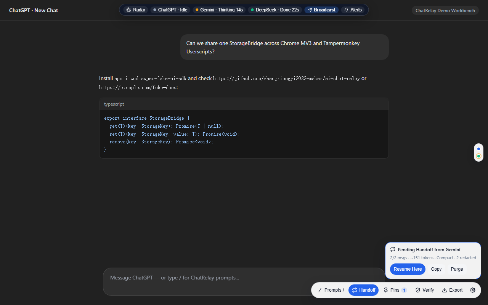
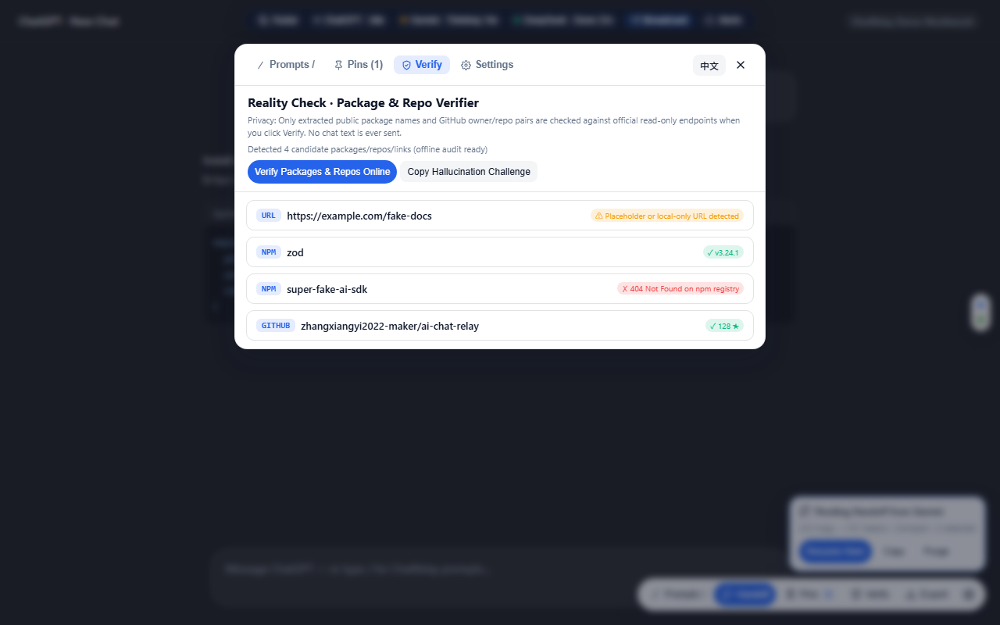
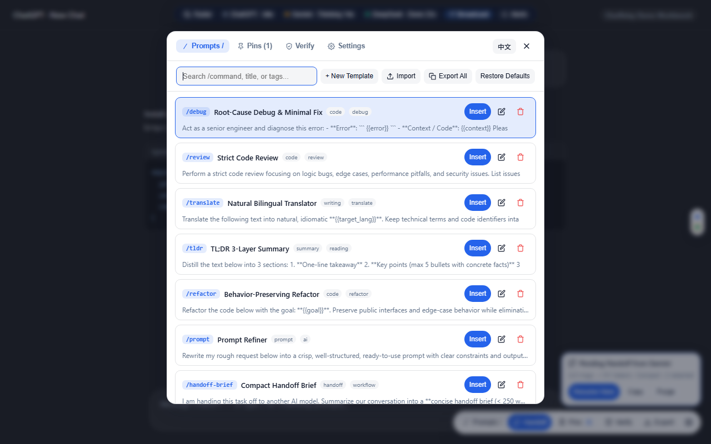
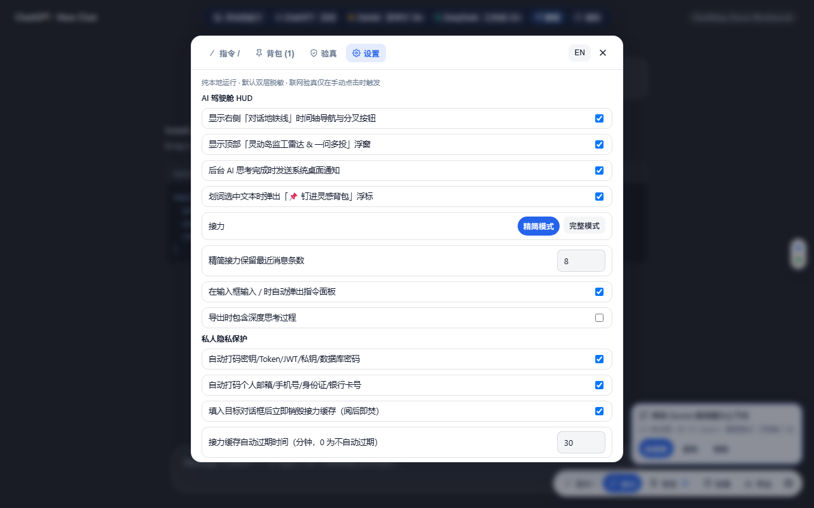

# ChatRelay — 全平台 AI 驾驶舱

[](https://github.com/zhangxiangyi2022-maker/ai-chat-relay/releases/latest)
[](https://github.com/zhangxiangyi2022-maker/ai-chat-relay/actions)
[](./LICENSE)
[](./PRIVACY.md)

[English README](./README.md) · [隐私保护声明](./PRIVACY.md) · [GreasyFork 安装](https://greasyfork.org/zh-CN/scripts/607263-chatrelay-cross-ai-prompt-context-handoff) · [申请适配新平台](https://github.com/zhangxiangyi2022-maker/ai-chat-relay/issues/new?template=platform_request.yml)

面向 **ChatGPT、Gemini、Claude、DeepSeek** 的轻量开源 **AI 驾驶舱 HUD**，一套 TypeScript 代码**一键双构建**出 **Chrome/Edge 扩展（MV3）** 与 **油猴脚本（`.user.js`）**。

## 界面预览

| 灵动岛监工 / 地铁线导航 / 一键接力 | 防幻觉包名与 GitHub 验真透视灯 |
| :---: | :---: |
|  |  |

| `/` 快捷指令与剧本面板 | 隐私开关与驾驶舱控制 |
| :---: | :---: |
|  |  |

## 核心功能（`v1.0`）

1. **右侧「对话地铁线」时间轴 & 任意楼层分叉**
   - 页面右侧常驻节点时间线，自动标识 `代码`、`公式`、`表格` 轮次；
   - 点圆点秒跳定位；支持 **「静音」** 划掉答偏的废话楼层；支持在任意轮次点 **「分叉到此处」** 开启干净新支线。
2. **顶部「灵动岛监工雷达」& 一问多投**
   - 实时监控后台已打开的所有 AI 标签页思考耗时与状态（`思考中 14s` / `已完成 22s` / `空闲`），支持在后台 AI 答完时弹系统桌面通知；
   - **群发（Broadcast）**：输入一次问题，一键同步投递到多个已打开的 AI 标签页（支持仅填入或尝试自动发送）。
3. **随手钉「灵感背包（Pinboard）」**
   - 在任意回答里划选文字秒弹 **`📌 钉进背包`**，或在地铁线节点点「钉住」跨平台收藏金句与代码；
   - 一键拼合导出成干净 Markdown 笔记，或打包喂给当前 AI 继续综合。
4. **防幻觉「包名与 GitHub 验真透视灯」**
   - 自动抽取回答里的 `npm` 包、`PyPI` 包、`GitHub` 仓库和占位可疑链接（`example.com` 等）；
   - 点击 **「联网核实存在性」** 仅向 `registry.npmjs.org`、`pypi.org`、`api.github.com` 查询公开包名/仓库是否存在与 Star/版本，遇到 404 幻觉可一键复制 **「打假追问话术」**。
5. **快捷 `/` 指令、无损导出 Markdown & 默认隐私保护**
   - 默认纯本地运行，接力/分叉/背包/导出前**自动打码 API Key、JWT、私钥、数据库密码及个人邮箱/手机号/身份证号**；
   - 缓存不存原对话 URL，支持阅后即焚与 30 分钟过期自毁。详见 [PRIVACY.md](./PRIVACY.md)。

## 支持平台

- **ChatGPT**：`https://chatgpt.com/`、`https://chat.openai.com/`
- **Gemini**：`https://gemini.google.com/`
- **Claude**：`https://claude.ai/`
- **DeepSeek**：`https://chat.deepseek.com/`

## 安装使用

### 方式一：Chrome / Edge 浏览器扩展（无需装油猴）

1. 前往 [GitHub Releases](https://github.com/zhangxiangyi2022-maker/ai-chat-relay/releases/latest) 下载 [`chat-relay-extension.zip`](https://github.com/zhangxiangyi2022-maker/ai-chat-relay/releases/latest/download/chat-relay-extension.zip) 并解压（或本地执行 `npm run build`）。
2. 在浏览器地址栏打开 `chrome://extensions/`（Edge 为 `edge://extensions/`），打开 **开发者模式** → **加载已解压的扩展程序** → 选择解压后的目录即可。

### 方式二：油猴脚本（Tampermonkey / Violentmonkey）

1. 先安装 **篡改猴（Tampermonkey）** 或 **暴力猴（Violentmonkey）**。
2. 前往 [GreasyFork 页面](https://greasyfork.org/zh-CN/scripts/607263-chatrelay-cross-ai-prompt-context-handoff) 或点击 [GitHub 直装脚本](https://github.com/zhangxiangyi2022-maker/ai-chat-relay/releases/latest/download/chat-relay.user.js) 一键安装。

## 本地开发与构建

```bash
npm install
npm run typecheck
npm test
npm run build
```

## 开源协议

[MIT](./LICENSE)
